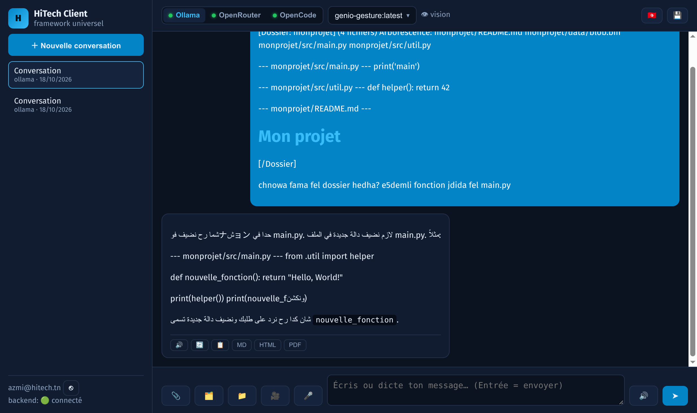
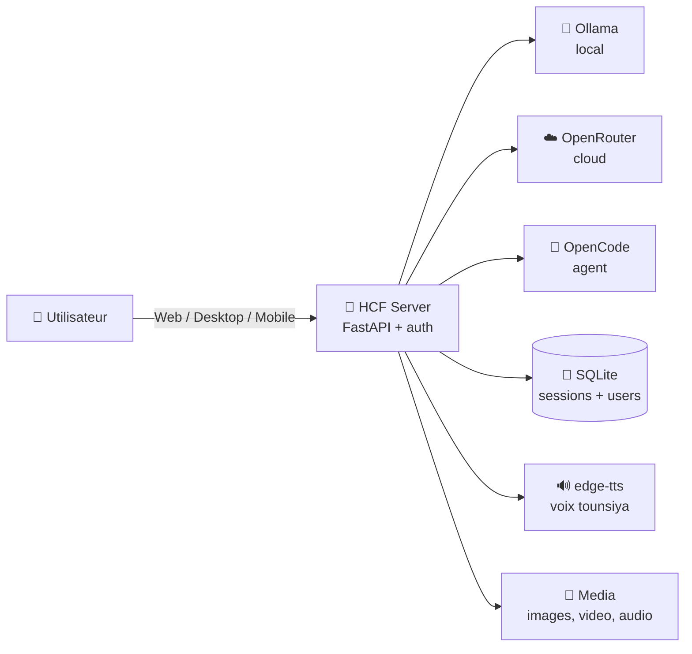

<div align="center">

# 🇹🇳 HiTech Client (HCF)

### Sa7bek AI — el kol fi blast wa7da 🚀

**Modèles locaux (Ollama) + Cloud (OpenRouter) + Agent (OpenCode)**
**fi interface wa7da, bedderja ettounseya, w bel 7ourouf el 3arbiya.**

[](LICENSE)
[](https://python.org)
[](#-chnowa-ya3mel)
[](https://github.com/HiTechTN)

[🎥 **Video tutoriel bedderja**](#-video-tutoriel) · [⚡ Démarrage rapide](#-kifech-tjarrab-fi-3-d9aye9) · [❓ FAQ](#-faq)



</div>

---

## 🤔 Chnowa HCF ?

**HiTech Client** houwa assistant AI **open-source** yjam3lek **el kol fi blast wa7da** :

- 🦙 **Ollama** — modèles 3la jihedek (offline, gratuit, privé)
- ☁️ **OpenRouter** — des centaines de modèles cloud (fama **free** zeda !)
- 🤖 **OpenCode** — agent code y9ra w yekteb fichiers
- 🗣️ **Voix tounsiya** — el réponses yet9raw bedderja **ettounseya el s7i7a** 🔊
- 📎 **Fichiers & dossiers** — 7ot ay fichier wela dossier kemel fel prompt
- 🌍 **Multi-langue** — yjaweb bedderja par défaut, w yemchi m3a ay langue tekteb biha

> 💡 **El fikra** : application wa7da, UI wa7da, w enty t7ot el "cerveau" elli t7eb —
> local wela cloud, w beddel binethom b clic wa7ed.

---

## ✨ Chnowa ya3mel ?

| | Feature | Chnowa tsir |
|---|---|---|
| 💬 | **Chat streaming** | Réponses live, kelma b kelma |
| 🇹🇳 | **Darija par défaut** | Yjaweb bedderja bel 7ourouf el 3arbiya — w ken tekteb français/anglais, yjaweb nafs el langue |
| 🔊 | **Lecture audio tounsi** | Voix ar-TN (Hedi/Reem) — not9 tounsi s7i7, play/stop ta7t koll réponse |
| 🔄 | **Régénérer** | Ma3jbekech el réponse ? A3idha b bouton wa7ed |
| 📋 | **Copier / Partager** | Koll réponse : copie, wela export **MD / HTML / PDF** |
| 📎 | **Fichiers locaux** | Ay fichier (code, txt, md…) → fel prompt direct |
| 🗂️ | **Dossiers kemlin** | Dossier kemel → arborescence + contenus → el model ychouf el kol |
| 🖼️ | **Vision** | Tsawer + frames mte3 videos |
| 🎤 | **Dictée** | Ahki w yetkteb |
| 👥 | **Comptes utilisateurs** | Email + PIN (SMTP), OAuth GitHub — koll wa7ed 3ando historique mte3ou |
| 💾 | **HiTech Drive** | Export conversations wela joindre fichiers mel Drive mte3ek |
| 🌐 | **3 plateformes** | Web (navigateur), Desktop (Tauri), Mobile (Capacitor/Android) |

---

## 🚀 Kifech tjarrab (fi 3 d9aye9)

### 1️⃣ Serveur

```bash
git clone https://github.com/HiTechTN/hitech-client.git
cd hitech-client

python3 -m venv .venv
source .venv/bin/activate
pip install -r server/requirements.txt

cp .env.service.example .env.service   # 7ot el token mte3ek
export HCF_PUBLIC_TOKEN="token-s7i7-mte3ek"

uvicorn hcf.app:app --host 0.0.0.0 --port 8096 --app-dir server
```

### 2️⃣ Ofta el navigateur

```
http://localhost:8096/
```

Login b email + PIN (SMTP) wela token admin. **Salam, chnowa ne3mlou ?** 👋

### 3️⃣ Desktop & Mobile (optionnel)

```bash
# Desktop (Tauri — Linux/Windows/macOS)
cd apps/desktop && npx tauri dev

# Mobile (Capacitor — Android)
cd apps/mobile && npm install && npm run apk
```

<details>
<summary>🔧 <b>Configuration avancée</b> (backends, modèles, OAuth…)</summary>

**`.env.service`** — el variables elli te7tajhom :

```ini
HCF_PUBLIC_TOKEN=...          # token d'accès (obligatoire)
OPENROUTER_API_KEY=sk-or-...  # modèles cloud (optionnel)
SMTP_HOST=smtp.gmail.com      # login par email (optionnel)
SMTP_PORT=465
SMTP_USER=...
SMTP_PASS=...
GITHUB_CLIENT_ID=...          # OAuth GitHub (optionnel)
GITHUB_CLIENT_SECRET=...
```

**Backends** — `server/hcf/config.py` : Ollama (local), OpenRouter (cloud),
OpenCode (agent). Zid/beddel kima t7eb.

**Modèles** — el UI tchouflek el kol automatiquement, m3a badges
`FREE` / `👁 vision` / taille contexte.

</details>

---

## 🏗️ Architecture



**Fichiers principaux :**

```
hitech-client/
├── server/hcf/          # FastAPI : app, auth, store, adapters, media
├── apps/web/            # UI web (HTML/JS/CSS — zero build)
├── apps/desktop/        # Tauri wrapper
├── apps/mobile/         # Capacitor (Android)
├── docs/                # API.md, ARCHITECTURE.md, EDGE.md
└── scripts/             # services systemd
```

---

## 🧠 Les modèles

| Backend | Win ? | Flous ? | Wa9tech yesta7el |
|---|---|---|---|
| 🦙 Ollama | 3la jihedek | 🆓 gratuit | Offline, privé, PC behi |
| ☁️ OpenRouter | Cloud | 💰 payant + **fama free** | Modèles 9wayes barcha |
| 🤖 OpenCode | Local/Cloud | 🆓 | Code, fichiers, projets |

> 💡 **Tip** : el modèles `:free` mte3 OpenRouter behin barcha lel test —
> ama fama limites (429). Ken tji 3la 429, estanna chwaya wela beddel modèle.

---

## 🔐 Sécurité

- 🔑 **Token public** obligatoire (`HCF_PUBLIC_TOKEN`) — el API el kol mahiya
- 👤 **Comptes** : PIN hashé + cooldown + limites, tokens signés HMAC (30j)
- 🏠 **Isolation** : koll user ychouf ken historique mte3ou
- 🍪 **Cookies** : `SameSite=None; Secure` + CSRF state lel OAuth

---

## 🎥 Video tutoriel

**Tutoriel complet bedderja** (80s) — sout tounsi s7i7 🔊 + sous-titres :

https://github.com/HiTechTN/hitech-client/raw/main/docs/video/hitech-client-tuto.mp4

> 📥 Le fichier est aussi attaché à la [release v1.0.0](https://github.com/HiTechTN/hitech-client/releases/latest)
> (sous-titres : `docs/video/tuto.srt`)

---

## ❓ FAQ

<details>
<summary><b>Lech bedderja bel 7ourouf el 3arbiya ?</b></summary>

5ater el **voix tounsiya** (ar-TN) ta9ra el darija bel 3arbi **not9 s7i7 100%**.
El arabizi (latin) yet9ra ghalet. W ken tekteb b français wela anglais,
el assistant yjaweb nafs el langue mte3ek — el darija ken **par défaut**.
</details>

<details>
<summary><b>Yekhdem offline ?</b></summary>

Eh ! M3a **Ollama** el kol yekhdem 3la jihedek — chat, fichiers, voix.
Ken el internet ta7, OpenRouter w OAuth yjiw nafs el 7aja.
</details>

<details>
<summary><b>Chnowa el 7aja elli te7tajha ?</b></summary>

Python 3.10+ w khouya. Ollama optionnel (lel modèles locaux).
El UI web : **zero build** — HTML/JS/CSS natifs.
</details>

<details>
<summary><b>Najjem nzid backend jdid ?</b></summary>

Eh — `server/hcf/adapters/` : implémenti `chat_stream()` mel base class,
register fel `config.py`, w el UI twarrih automatiquement.
</details>

---

## 🗺️ Roadmap

- [x] Chat multi-backend + streaming
- [x] Darija par défaut + voix tounsiya
- [x] Comptes (PIN + OAuth GitHub)
- [x] Fichiers & dossiers fel prompt
- [x] Export MD / HTML / PDF
- [ ] HiTech Drive par utilisateur
- [ ] Création repos GitHub mel chat
- [ ] OAuth Google
- [ ] iOS (Capacitor)

---

## 🤝 Tekmoul

El projet **open-source** (MIT) — el 3awn mrigel ! 🙏

```bash
git clone https://github.com/HiTechTN/hitech-client.git
cd hitech-client
# 3mel branch, beddel, w a3mel PR 🚀
```

**Idées ? Bugs ?** → [Issues](https://github.com/HiTechTN/hitech-client/issues)

---

<div align="center">

**🇹🇳 Sna3ou b7obba fi Tunisie**

[⬆ Raja3 lel fou9](#-hitech-client-hcf)

</div>
